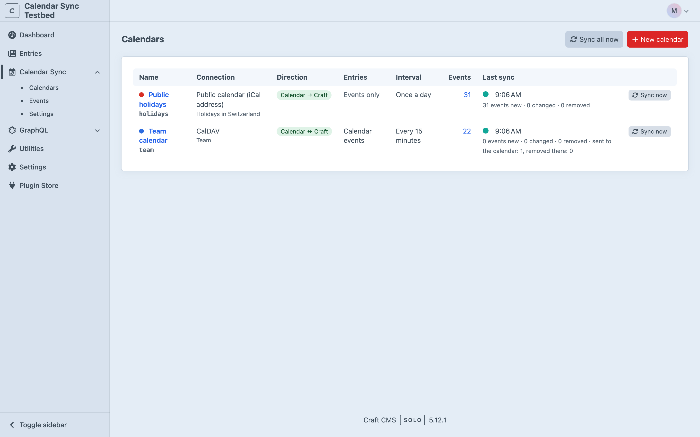
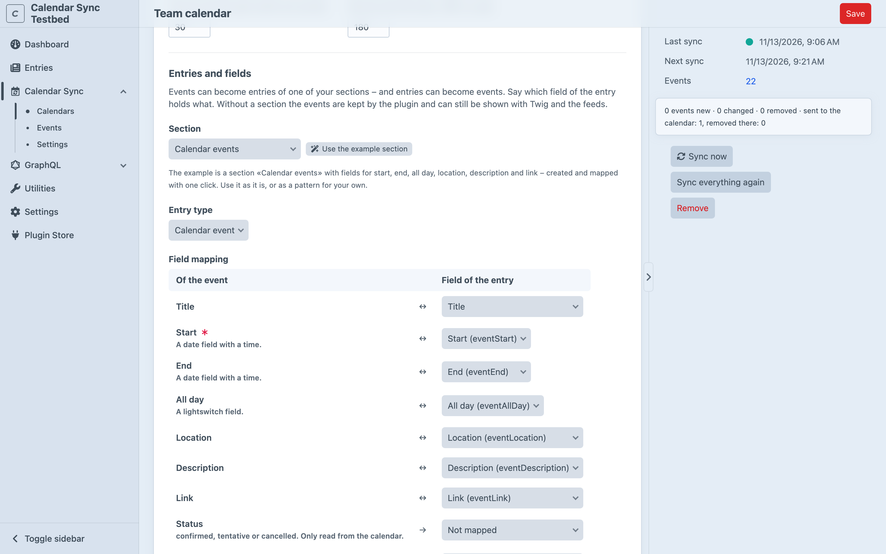
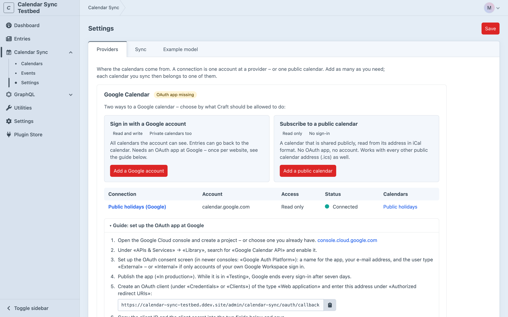
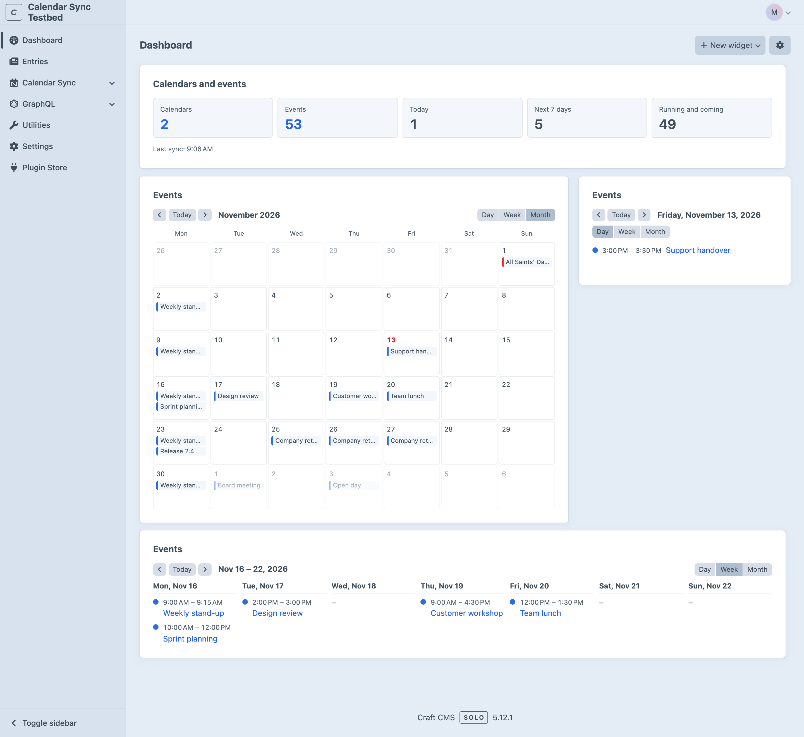

# Calendar Sync for Craft CMS

[](https://craftcms.com/)
[](https://php.net/)
[](LICENSE.md)

Connect **Google Calendar**, **Microsoft 365 / Outlook** and any **CalDAV** calendar (Nextcloud, iCloud, Fastmail,
mailbox.org …) to Craft. Sync events in either direction, map them to the fields of your own entries, and present
them with Twig, an iCalendar feed and a JSON feed.

> One calendar, kept in one place – and the website shows it. Or the other way round: the events you publish on the
> website appear in the calendar your team already uses.

## Features

- **Three providers** – Google Calendar (Calendar API), Microsoft 365 / Outlook.com / Exchange Online (Microsoft Graph)
  and CalDAV. Several accounts side by side, several calendars per account.
- **Public calendars without a sign-in** – subscribe to a Google calendar that is shared publicly, or to any other
  calendar address in iCal format (`.ics`). Read only, no OAuth app needed.
- **Read, write, or busy times only** – set per connection what Craft may do: read and write, read only, or only
  keep *when* something takes place – no title, no place, no text.
- **Three directions, per calendar** – *Calendar → Craft*, *Craft → Calendar*, or *both ways*.
- **Your data, your fields** – choose a section and an entry type and say which field holds the start, the end, «all
  day», the location, the description and the link. Only fields that can hold the value are offered. What is not
  mapped is left alone on both sides: guests, reminders and attachments of an event survive a change made in Craft.
- **An example model with one click** – no place for events yet? The plugin creates a section «Calendar events» with
  the six fields an event needs and maps it. Use it as it is, or as a pattern for your own.
- **Or no entries at all** – without a section the events are simply kept by the plugin and are just as easy to show.
- **Sync settings** – per calendar: how often (every 5 minutes to once a day, or only manually), how many days back
  and ahead, what happens to an entry when its event leaves the calendar (delete, disable, keep), and who wins when
  both sides changed. Globally: automatic sync on or off, sending entries the moment they are saved, defaults for
  new calendars.
- **Changes travel fast** – an entry that is saved, deleted or restored is sent to its calendar right away, through
  the queue.
- **Repeating events** – read as their single occurrences inside the synced period.
- **Presenting** – `craft.calendarSync.events()` for Twig, GraphQL queries, a public iCalendar feed visitors can
  subscribe to, and a JSON feed in the format of FullCalendar.
- **A colour and a prefix per calendar** – the colour shows in lists, widgets and feeds; the prefix goes in front of
  the title of every entry made from an event.
- **Description the way you need it** – keep or drop line breaks, list attached documents (Google Drive) as links,
  turn web addresses into links.
- **Dashboard widgets** – a counter (calendars, events, today, the next seven days) and an events widget with a day,
  week and month view.
- **A log and a trial run** – every run leaves a line with what it did, change by change; a trial run shows what
  the next run would do without writing anything.
- **Filters** – leave out private events, or only take events with certain words or categories.
- **Told when something breaks** – a notice in the control panel and, if you like, an e-mail when a calendar fails
  or the Microsoft client secret is about to run out.
- **Add to calendar and structured data** – links that put an event into a visitor's Google, Outlook or other
  calendar, and schema.org data for search engines.
- **For operations** – console commands for a cron job, a queue job per run, user permissions, the result of the last
  run on every calendar. Tokens and passwords are stored encrypted.
- Interface in English, German (with Swiss spelling), French, Italian and Spanish.

## Screenshots









## Requirements

- Craft CMS 5.3 or later, PHP 8.2 or later
- MySQL, MariaDB or PostgreSQL
- For Google and Microsoft: an OAuth app of your own (free, set up once – see below)

## Installation

From the Plugin Store, or with Composer:

```bash
composer require pixelwerft/calendar-sync
```

```bash
php craft plugin/install calendar-sync
```

## Getting started

1. **Add a provider** – *Calendar Sync → Settings → Providers*. Google, Microsoft and CalDAV each have a card there
   with a step-by-step guide and the connections you have made. For Google and Microsoft you sign in; for CalDAV
   you enter the address of the server, a user name and a password; a public calendar only needs its address.
2. **Add a calendar** – *Calendar Sync → Calendars → New calendar*. Choose the connection, one of its calendars, the
   direction and how often it is synced.
3. **Map it** – choose a section and the fields, or use the example model (*Settings → Example model*, or the button
   in the calendar form). Or leave the section empty to only keep the events.
4. Save. The first run starts at once; its result appears in the list.

### Google Calendar

In the [Google Cloud console](https://console.cloud.google.com/):

1. Create a project and enable the **Google Calendar API**.
2. Set up the **OAuth consent screen**. Publish it (*In production*): while it is in *Testing*, Google ends every
   sign-in after seven days. For a Google Workspace organisation the type *Internal* needs no review.
3. Create an **OAuth client ID** of the type *Web application* and add the redirect address shown in the plugin
   settings under *Authorised redirect URIs*.
4. Enter the client ID and the client secret in *Calendar Sync → Settings → Providers*. Both fields take
   environment variables (`$CRAFT_GOOGLE_CLIENT_ID`, `$CRAFT_GOOGLE_CLIENT_SECRET`).

The plugin asks for these scopes: `calendar.readonly` (to list the calendars of the account and read their events)
and – only for a connection that may write – `calendar.events`.

#### A public Google calendar, without an OAuth app

A calendar that is shared publicly can be read from its address, with no sign-in at all:

1. In Google Calendar, open *Settings* and choose the calendar.
2. Under *Access permissions for events*, tick *Make available to public*.
3. Under *Integrate calendar*, copy the *Public address in iCal format*.
4. In *Calendar Sync → Settings → Providers*, choose *Add a public calendar* and paste the address. The ID of a
   public Google calendar works too, and so does any other calendar address in iCal format (`.ics`, `webcal://`).

Such a connection is read only.

### Microsoft 365 / Outlook

In the [Microsoft Entra admin center](https://entra.microsoft.com/):

1. *App registrations → New registration*. Choose who may sign in, and add the redirect address shown in the plugin
   settings as a **Web** platform.
2. *Certificates & secrets* → create a client secret and copy its **value**.
3. *API permissions* → add the delegated Microsoft Graph permissions `Calendars.ReadWrite`, `User.Read` and
   `offline_access`. If every connection only reads, `Calendars.Read` is enough.
4. Enter the application (client) ID, the secret and – if the app is registered for one organisation only – the tenant
   ID in *Calendar Sync → Settings → Providers* (`$CRAFT_MICROSOFT_CLIENT_ID`, `$CRAFT_MICROSOFT_CLIENT_SECRET`).
   The default tenant `common` accepts work, school and private accounts.

### CalDAV

Enter the address your provider gives you; the plugin finds the calendars of the user from there.

| Provider | Address | Password |
| --- | --- | --- |
| iCloud | `https://caldav.icloud.com` | an app-specific password |
| Nextcloud | `https://cloud.example.com/remote.php/dav` | an app password if two-factor sign-in is on |
| Fastmail | `https://caldav.fastmail.com` | an app password |
| mailbox.org | `https://dav.mailbox.org` | your password |

### What a connection may do

Every connection has an access level; it applies to all of its calendars.

| Access | |
| --- | --- |
| **Read and write** | Events come to Craft, entries can go to the calendar. |
| **Read only** | Events come to Craft; the calendar is never changed. Google and Microsoft are only asked for the right to read. |
| **Busy times only** | Craft keeps when something takes place, not what: every event gets the title you set («Busy»), and titles, places, descriptions, links, organizers and documents are not stored. Events marked as «free» are left out. |

Changing the access of a connection reads its calendars again from the start. A connection that shall write after it
only read has to sign in again.

### Filters

Each calendar can say which of its events come to Craft (*Filters* in the calendar form):

- **Leave out private events** – what is marked as private or confidential in the calendar stays there.
- **Only events with** – words or categories, separated by commas. An event needs one of them in its title,
  description, location or categories (Outlook and iCalendar have categories; Google has none).
- **No events with** – events that have one of these words stay out.

An event that is left out is treated as if it were not in the calendar: if it was synced before, its entry is
deleted, disabled or kept – as the calendar is set. Events made from entries are never left out.

## How the sync works

One run of a calendar looks at the period set for it (days back, days ahead) and

1. reads the events of the calendar and brings Craft up to date – *Calendar → Craft* and *both ways*,
2. reads the live entries of the section and brings the calendar up to date – *Craft → Calendar* and *both ways*.

Changes are found by fingerprints of the event and of the entry as they were at the last run. If only one side
changed, the other follows. If both changed, the side you chose wins.

| What happens | Result |
| --- | --- |
| New event in the calendar | A new entry (if a section is mapped) |
| Event changed in the calendar | The mapped fields of its entry are written again |
| Event deleted or cancelled in the calendar | Its entry is deleted, disabled or kept – as set for the calendar |
| New live entry in the section | A new event in the calendar |
| Entry changed | The mapped attributes of its event are written; everything else of the event stays |
| Entry deleted | Its event is deleted in the calendar |
| Entry disabled | Its event is removed from the calendar if it was created from Craft; an event that was created in the calendar stays there |

Good to know:

- **All-day events** keep their days in every time zone. In an entry the start is the first day and the end the
  *last* day of the event, both at midnight.
- **Repeating events** are read as single occurrences, each with its own entry if a section is mapped. They are not
  written back: change the series in the calendar.
- **Entries without a start** are not sent to the calendar. Without an end, an event lasts as long as set in the
  settings (60 minutes by default).
- **Microsoft** has no field for a link, so the link of an entry is not written there. An online meeting link is read.
- **Descriptions** are plain text in Microsoft and CalDAV calendars. A rich text field is converted on the way.
- Imported entries are saved without checking required fields the mapping does not fill, so a missing value never
  stops the sync.

### When the sync runs

- **Automatically** – while people use the site, the plugin checks once a minute which calendars are due and puts
  them on the queue.
- **By cron job** – for a sync that runs on time, also at night:

  ```bash
  */5 * * * * php /path/to/craft calendar-sync/sync
  ```

- **By hand** – *Sync now* in the control panel.
- **On save** – an entry of a mapped section goes to its calendar right after it was saved.

### Trial run

*Trial run* on a calendar shows what the next run would do – events and entries that would be created, changed or
removed, what would be sent to the calendar, conflicts – and writes nothing, neither in Craft nor in the calendar.
Use it before the first sync in both directions, or after changing the mapping or the filters. It works with the
calendar as it is saved.

### The log

*Calendar Sync → Log* lists the runs of all calendars: when, what started them, how long they took, the numbers and
every single change, and what went wrong. Runs are kept for 30 days (*Settings → Sync*; 0 switches the log off).

### Notifications

While a calendar fails or a connection needs its account again, the control panel shows a notice on every page. With
*Send an e-mail when a calendar fails* (*Settings → Sync*) the plugin also sends one message when a calendar starts
to fail and one a day while it keeps failing.

Microsoft does not tell an app when its client secret ends. Enter the date next to the secret
(*Settings → Providers → Microsoft*) and the plugin warns thirty days before.

### Console commands

```bash
php craft calendar-sync/sync            # the calendars that are due
php craft calendar-sync/sync team       # one calendar, by its handle
php craft calendar-sync/sync --all      # every enabled calendar
php craft calendar-sync/sync --force    # write every entry again (after the mapping changed)
php craft calendar-sync/sync --queue    # put the runs on the queue instead of running them here
php craft calendar-sync/sync team --dry-run   # only say what a run would do
php craft calendar-sync/sync/status     # the calendars and how their last run ended
```

## Presenting events

### Twig

```twig



  <article>
    <h3>{{ event.title }}</h3>
    <p>
      {{ event.startDate|date('medium') }}
      {{ event.startDate|time('short') }} – {{ event.endDate|time('short') }}
       – {{ event.endDate|date('medium') }}
    </p>
    <p>{{ event.location }}</p>
    {{ event.descriptionHtml|raw }}
  </article>

```

The query:

| Method | What it finds |
| --- | --- |
| `.calendar('team')` | Events of one calendar – a handle, an ID or a list of them |
| `.upcoming()` | Running and coming events, the next one first |
| `.past()` | Events that are over, the latest first |
| `.today()`, `.day(date)`, `.month(date)` | Events of a day or of a month |
| `.range(from, to)`, `.after(date)`, `.before(date)` | Events that touch a period |
| `.search('text')` | Text in title, description or location |
| `.allDay()`, `.recurring()`, `.hasEntry()` | Only such events; pass `false` for the opposite |
| `.status('cancelled')` | By status; `null` for any. Cancelled events are left out by default |
| `.orderBy('startDate desc')`, `.limit(n)`, `.offset(n)` | Order and paging |
| `.withEntries()` | Loads the entries along, for lists that use `event.entry` |
| `.all()`, `.one()`, `.count()`, `.exists()`, `.byDay()` | The result; `byDay()` groups by the day an event starts on |

Criteria can also be passed at once: `craft.calendarSync.events({ calendar: 'team', upcoming: true, limit: 5 })`.

An event:

| Property | |
| --- | --- |
| `title`, `description`, `descriptionHtml`, `location`, `url` | `descriptionHtml` is cleaned HTML, formatted the way the calendar is set up |
| `attachments` | Documents attached to the event, e.g. from Google Drive: a list of `title` and `url` |
| `startDate`, `endDate` | In the time zone of the site. For an all-day event `endDate` is its last day |
| `allDay`, `isMultiDay`, `isUpcoming`, `isOngoing`, `isPast`, `duration` | `duration` in minutes |
| `status`, `isCancelled`, `organizer`, `recurring` | |
| `calendar` | The calendar: `name`, `handle`, `color`, `entryPrefix`, `feedUrl` |
| `addToCalendarLinks`, `addToCalendarUrl(type)` | Links that put the event into a visitor's calendar – see below |
| `jsonLd`, `jsonLdScript` | The event as structured data (schema.org) – see below |
| `entry` | The mapped entry, if it is live |

If a section is mapped, the events are ordinary entries too – query them the way you query any entry:

```twig

```

### Add to calendar

```twig
<ul>
  
    <li><a href="{{ link.url }}" rel="nofollow">{{ link.label }}</a></li>
  
</ul>
```

The links are for Google Calendar, Outlook.com, Microsoft 365 and a calendar file (`.ics`) that every calendar app
opens. For a single one: `event.addToCalendarUrl('google')` – `google`, `outlook`, `office365` or `ics`. The address
of the calendar file carries a signature, so it only works for events a template has linked to.

### Structured data

```twig
{# one event, e.g. on its detail page #}
{{ event.jsonLdScript }}

{# a list of events #}
{{ craft.calendarSync.jsonLd(events) }}
```

Both write a `<script type="application/ld+json">` tag with schema.org `Event` data: name, start and end, status,
description, location and the address of the entry.

### The description

Each calendar says how the description of its events is formatted (*Description* in the calendar form):

- **Keep line breaks** – off, the description becomes one paragraph of running text.
- **List attached documents** – documents attached to an event (Google Drive files, links in an iCal file) are listed
  as links below the description.
- **Turn addresses into links** – web addresses in the text become links. This happens when the description is shown;
  the stored text stays as it is.

The options apply to `event.descriptionHtml`, to GraphQL and the widgets – and to the entries of a calendar that only
comes to Craft. A calendar that syncs both ways keeps its text as it is, so nothing is lost on the way back.

### GraphQL

Allow *Calendar Sync → Query the events and calendars* in a schema, then:

```graphql
{
  calendarSyncEvents(calendar: ["team"], upcoming: true, limit: 10) {
    title
    startDate @formatDateTime(format: "Y-m-d H:i")
    endDate
    allDay
    location
    descriptionHtml
    attachments { title url }
    calendar { handle name color }
    entry { title url }
  }
  calendarSyncEventCount(calendar: ["team"], upcoming: true)
  calendarSyncCalendars { handle name color feedUrl }
}
```

An event also has `addToCalendarUrl(type: "google")` and `jsonLd` (as a JSON string).

`calendarSyncEvents`, `calendarSyncEvent` and `calendarSyncEventCount` take `id`, `calendar`, `after`, `before`,
`upcoming`, `past`, `today`, `day`, `month`, `search`, `allDay`, `recurring`, `hasEntry`, `entryId`, `orderBy`,
`limit` (100 by default, 1000 at most) and `offset`. `entry` is only returned if the schema may query the section
of the entry.

### Dashboard widgets

- **Calendar Sync: numbers** – calendars, events, events today, in the next seven days, running and coming; for all
  calendars or one.
- **Calendar Sync: events** – the events of a day, a week or a month, in the colours of their calendars. The month
  opens a day with a click.

### Feeds

Switch on *Public feed* for a calendar to get two addresses:

- **iCalendar** (`….ics`) – to subscribe to in Apple Calendar, Google Calendar, Outlook and others.
- **JSON** (`….json`) – in the format of [FullCalendar](https://fullcalendar.io/); it takes `start` and `end`.

```twig
<a href="{{ craft.calendarSync.feedUrl('team') }}">Subscribe to the calendar</a>
```

Anyone who knows the address can read the events of that calendar; the address contains a random token.

More examples – a list by day, a month view and FullCalendar – are in [`examples/`](examples).

## Settings

*Calendar Sync → Settings* has three tabs: **Providers** (the connections, the guides and the OAuth apps), **Sync**
and **Example model**. The same settings in `config/calendar-sync.php`:

```php
<?php

return [
    'googleClientId' => '$CRAFT_GOOGLE_CLIENT_ID',
    'googleClientSecret' => '$CRAFT_GOOGLE_CLIENT_SECRET',
    'microsoftClientId' => '$CRAFT_MICROSOFT_CLIENT_ID',
    'microsoftClientSecret' => '$CRAFT_MICROSOFT_CLIENT_SECRET',
    'microsoftTenant' => 'common',

    // queue due calendars while people use the site; off if a cron job runs the console command
    'autoSync' => true,
    // send an entry to its calendar right after it was saved
    'syncOnSave' => true,

    // defaults of a new calendar: minutes between two runs, days back, days ahead
    'defaultInterval' => 60,
    'defaultPastDays' => 30,
    'defaultFutureDays' => 365,

    // minutes an event lasts when an entry has a start but no end
    'defaultEventDuration' => 60,
    // seconds to wait for a provider
    'requestTimeout' => 30,

    // days the log keeps the runs; 0 = no log
    'logDays' => 30,
    // an e-mail when a calendar starts to fail, and before the Microsoft client secret runs out
    'notifyOnError' => false,
    // who gets it, separated by commas; empty = the address the site sends its mail from
    'notificationEmails' => '$CRAFT_CALENDAR_SYNC_NOTIFY',
    // the day the Microsoft client secret runs out, to be warned thirty days before
    'microsoftSecretExpires' => '2028-11-19',
];
```

Connections and calendars are stored in the database, not in project config: they belong to one environment and can
be changed where admin changes are switched off. The fields of the settings themselves are project config and can
only be changed where admin changes are allowed.

## Permissions

- **Access Calendar Sync** – see the calendars and the events
- **Start a sync**
- **Set up calendars and their field mapping**
- **Manage the connections to Google, Microsoft and CalDAV**

## Extending

Add a calendar service of your own by implementing `pixelwerft\calendarsync\providers\ProviderInterface`:

```php
use craft\events\RegisterComponentTypesEvent;
use pixelwerft\calendarsync\services\Providers;
use yii\base\Event;

Event::on(Providers::class, Providers::EVENT_REGISTER_PROVIDERS, function(RegisterComponentTypesEvent $event) {
    $event->types[] = MyProvider::class;
});
```

## Support

Questions and bugs: [GitHub issues](https://github.com/pixelwerft/calendar-sync/issues) or ahoi@pixelwerft.ch.

Made by [pixelwerft](https://pixelwerft.ch).
